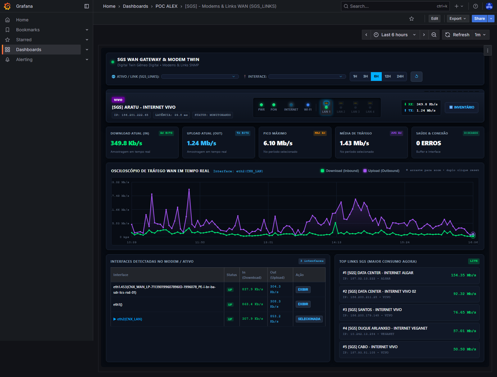
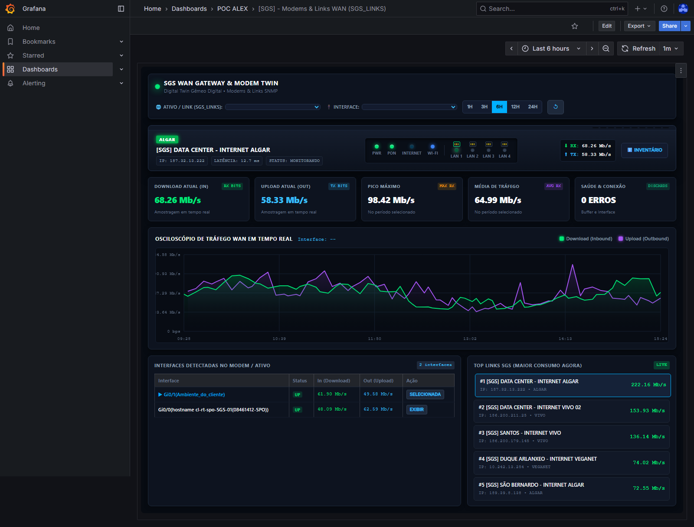

# 🌐 Gêmeo Digital de Modems & Links WAN (SGS_LINKS)

> **Solução de Observabilidade Avançada em Tempo Real para Gateways, Roteadores e Links de Telecomunicação**  
> Desenvolvido com **Zabbix 7.0 LTS**, **Grafana OSS** e painel dinâmico em **HTML5 Canvas 60 FPS**.

---

## 📸 Visão Geral da Interface


---

## 🎯 Destaques do Projeto

### 1. Chassi Físico Interativo do Modem
- **Faceplate Metálica Escovada**: Textura de chassi industrial com chanfros realistas e grelha superior de ventilação.
- **Identificação Automática da Operadora**: Reconhecimento dinâmico com badge oficial e paleta correspondente:
  - **VIVO FIBRA** (Roxo Vivo `#660099`)
  - **ALGAR TELECOM** (Verde Algar `#00b04f`)
  - **VEGANET** (Azul `#0088cc`)
  - **DESKTOP** (Laranja `#ff6600`)
  - **STARLINK**, **HUGHESNET**, **EMBRATEL**, **OI**, etc.
- **LEDs de Diagnóstico Frontais Realistas:**
  - ⚡ **PWR**: Verde esmeralda sólido (`#00e676`), indica equipamento ligado e acessível.
  - 🟢 **PON / FIBRA**: Indicador de sincronismo óptico/WAN da operadora. Clicável para retornar à visualização da WAN.
  - 🌐 **INTERNET (WAN)**: LED azul ciano com animação orgânica de cintilação (*traffic flicker*) cuja frequência acelera ou desacelera dinamicamente conforme o volume de bits por segundo trafegados naquele segundo. Clicável para focar no link WAN.
  - 📶 **WI-FI**: Indicador de rádio sem fio ativo.
- **Portas LAN 1 a 4 100% Funcionais e Dinâmicas**:
  - Mapeadas diretamente para as interfaces físicas e lógicas cadastradas no Zabbix (`eth2(CNX_LAN)`, `Gi0/0/0`, etc.).
  - **Porta Conectada**: Conector RJ45 blindado ativo com pinos dourados e LED verde piscando conforme os pacotes daquela porta.
  - **Porta Desconectada**: Conector apagado e LED desligado (opacidade reduzida), refletindo a realidade física do ativo em produção (sem simulações estáticas).
  - **1-Click Switching**: Clicar em qualquer porta LAN seleciona imediatamente aquela interface no osciloscópio, atualizando todos os KPIs e destacando a porta no chassi com auréola ciano.
- **Gaveta de Inventário (`ℹ️ INVENTÁRIO`)**: Painel retrátil lateral com dados cadastrais do Zabbix, Host ID, templates vinculados e link direto para o Zabbix Web.

---

### 2. Osciloscópio de Tráfego WAN / LAN (Canvas HTML5 a 60 FPS)
- **Curvas Duplas Simultâneas**:
  - **Download (Inbound)**: Traçado verde esmeralda (`#00e676`) com preenchimento em gradiente translúcido.
  - **Upload (Outbound)**: Traçado roxo (`#a855f7`) com preenchimento suave.
- **Inspeção no Hover**:
  - **Barrinha Guia Vertical Tracejada**: Segue o cursor conectando o topo do gráfico à base de tempo.
  - **Bolinhas Amostrais nas Curvas**: Cada ponto da amostragem possui um marcador circular conectado pelo traçado.
  - **Marcadores com Auréola Luminosa (*Target Halos*)**: Auréolas iluminadas de 10px com anel interno branco de alto contraste exatamente nas curvas no timestamp inspecionado.
- **Cápsula Flutuante Superior (*HUD Pill*)**:
  - Exibe `[ HH:MM:SS | ● In: X Mb/s | ● Out: Y Mb/s | Total: Z Mb/s ]` com reposicionamento dinâmico inteligente para evitar cortes nas extremidades do canvas.
- **Escala de Eixo Y Inteligente**: Adaptação contínua e automática entre bps, Kb/s, Mb/s e Gb/s com 15% de margem de topo (*headroom*).
- **Drag-to-Zoom Interativo**: Seleção de área por arraste do mouse para zoom microscópico de picos com botão flutuante `[ ↺ RESET ZOOM ]` e atalho de duplo clique.

---

### 3. Seletor Dinâmico de Ativos (33 Modems em 1 Painel)
- **Menu Suspenso Inteligente**: Alternância instantânea entre qualquer modem da rede sem recarregar a página.
- **Seletor de Intervalo de Tempo (`1H`, `3H`, `6H`, `12H`, `24H`)**: Ajusta a janela de telemetria instantaneamente.
- **Tabela de Interfaces**: Relação de todas as interfaces físicas e lógicas do modem selecionado (status operacional UP/DOWN, Download, Upload e botão de seleção rápida).
- **Top 5 Links SGS (Ao Vivo)**: Ranking ordenado em tempo real dos modems com maior consumo de internet no momento, permitindo chavear diretamente para as filiais mais congestionadas com 1 clique.

---

## 🔍 Galeria de Demonstração

### Inspeção no Osciloscópio (Hover Guideline & Halos)


### Detalhe do Osciloscópio


### Interatividade das Portas LAN (LAN 1 Selecionada)


### Link Corporativo Data Center Algar Telecom


---

## 🛠️ Arquitetura e Tecnologias

- **Backend / Telemetria:** Zabbix 7.0 LTS via API JSON-RPC (`history.get`, `item.get`, `host.get`).
- **Frontend / Visualização:** Grafana 10+ OSS.
- **Renderizador Gráfico:** Plugin `marcusolsson-dynamictext-panel` com JavaScript nativo em HTML5 Canvas e Handlebars.
- **Automação e Deploy:** Script Python [`scripts/build_sgs_modem_twin.py`](scripts/build_sgs_modem_twin.py).

---

## 🚀 Como Implantar

### 1. Pré-requisitos
- Python 3.10+
- Acesso à API do Zabbix (Token ou usuário com permissão de leitura no grupo `SGS_LINKS`).
- Acesso à API do Grafana (Token de serviço ou credenciais de administrador).

### 2. Instalação de Dependências
```bash
pip install -r requirements.txt
```

### 3. Configuração do `.env`
Crie um arquivo `.env` na raiz do projeto com as credenciais:
```ini
ZABBIX_URL=http://10.10.1.26/api_jsonrpc.php
ZABBIX_TOKEN=seu_token_api_zabbix

GRAFANA_URL=http://10.10.1.25:3000
GRAFANA_USER=admin
GRAFANA_PASSWORD=sua_senha
GRAFANA_FOLDER_ID=136
```

### 4. Executar o Build e Deploy
```bash
python scripts/build_sgs_modem_twin.py
```
O script irá:
1. Consultar todos os modems e roteadores ativos no grupo `SGS_LINKS`;
2. Identificar e ordenar as interfaces WAN e LAN com telemetria ativa;
3. Gerar os pacotes JSON e HTML sanitizados;
4. Publicar e atualizar o dashboard diretamente no Grafana.

---

## 📄 Licença e Propriedade
Desenvolvido por **IDhexter / SGS Brasil**. Todos os direitos reservados.
