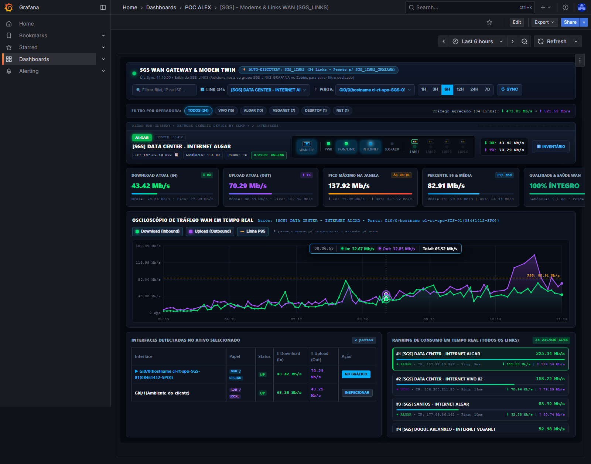
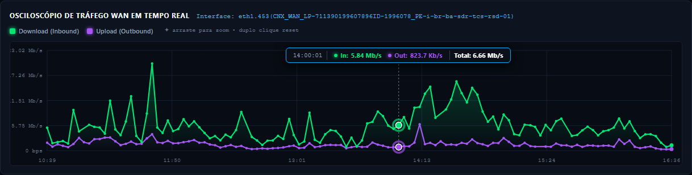

# 🌐 Gêmeo Digital de Modems & Links WAN (`SGS_LINKS_GRAFANA`)

> **Solução de Observabilidade Avançada em Tempo Real com Auto-Discovery Dinâmico para Gateways, Roteadores e Links WAN SNMP**  
> Desenvolvido com **Zabbix 7.0 LTS**, **Grafana OSS** e painel dinâmico em **HTML5 Canvas 60 FPS**.

---

## 📸 Visão Geral da Interface (`v12`)

> 📘 **Documentação Técnica & Manual do NOC:** Consulte o [**Manual Operacional NOC & Arquitetura Técnica**](docs/MANUAL_NOC_E_ARQUITETURA.md) para detalhes sobre a inclusão automática de novos links no grupo `SGS_LINKS_GRAFANA` e mapeamento de portas SNMP.


---

## ⚡ Auto-Discovery Dinâmico no Zabbix (`SGS_LINKS_GRAFANA`)

O painel conta com um motor **Zero-Touch Auto-Discovery** que consulta a API JSON-RPC do Zabbix diretamente pelo navegador em tempo real (`syncCatalogFromZabbix()`):

1. **Grupo Dedicado `SGS_LINKS_GRAFANA`**:
   - Sempre que alguém da equipe do **NOC** adicionar um novo link/modem SNMP ao grupo **`SGS_LINKS_GRAFANA`** no Zabbix, ele **aparece automaticamente na lista da dashboard, nas pílulas de operadora e no ranking ao vivo** (a cada 45 segundos em segundo plano ou imediatamente ao clicar no botão **`↻ SYNC`**), sem precisar rodar scripts ou editar o Grafana.
   - Mesmo que um ativo recém-cadastrado ainda esteja aguardando a descoberta de interfaces SNMP (*Low-Level Discovery - LLD*), ele já é listado imediatamente para o NOC com status `AGUARDANDO DESCOBERTA SNMP (LLD)...`.
2. **Fallback Inteligente (`SGS_LINKS`)**:
   - Enquanto o grupo `SGS_LINKS_GRAFANA` estiver vazio ou ainda não tiver sido criado/liberado para o usuário da API (`Read-only`), a dashboard opera automaticamente sobre o grupo `SGS_LINKS` (filtrando apenas links SNMP com tráfego ativo e ignorando switches) e exibe o badge de status no topo.

---

## 🎯 Destaques do Projeto & Layout (`v12`)

### 1. Barra Superior de Controle, Busca Instantânea e Filtro por Operadora
- **Busca Instantânea (`🔍 Filtrar filial, IP ou ISP...`)**: Filtra em tempo real o menu seletor e o ranking lateral por nome da localidade, endereço IP ou operadora.
- **Pílulas de Filtro Rápido por Operadora**: Botões dinâmicos com contagem ao vivo (`TODOS`, `VIVO`, `ALGAR`, `VEGANET`, `DESKTOP`, `NET`, etc.) + indicador de **Tráfego Agregado do Grupo** (`⬇ Download Total` e `⬆ Upload Total` somados de todos os links).
- **Janelas de Tempo Estendidas (`1H`, `3H`, `6H`, `12H`, `24H`, `7D`)**: Suporte automático a `history.get` (alta resolução) e `trend.get` (histórico longo de 7 dias).

### 2. Chassi Físico Interativo 1U do Gateway / ONT
- **Faceplate Metálica em Linha Única**: Acabamento em alumínio anodizado escuro com grelha de ventilação superior, modelo de template SNMP e identificação do `HOSTID`.
- **Pílulas de Diagnóstico**:
  - **IP Clicável (`📋`)**: Copia o endereço IP da gerência/WAN para a área de transferência com 1 clique.
  - **Latência ICMP (`ms`) & Perda de Pacotes (`%`)**: Monitoramento em tempo real da saúde da conexão.
- **Porta Óptica `WAN SFP` + Cluster de LEDs Reais**:
  - **`WAN SFP`**, **`PWR`**, **`PON/LINK`**, **`INTERNET`** (com *traffic flicker* proporcional à banda) e **`LOS/ALM`** (alarme visual âmbar/vermelho em caso de perda de pacotes ou queda de link).
- **Portas `LAN 1` a `LAN 4` 100% Funcionais**:
  - Conectores RJ45 blindados com pinos dourados mapeados para as interfaces LAN reais do ativo no Zabbix (`Gi0/1(Ambiente_do_cliente)`, `eth2(CNX_LAN)`, etc.).
  - Clicar em qualquer porta LAN ativa ou no bloco WAN chaveia imediatamente o osciloscópio para inspecionar aquela interface.

### 3. 5 Cards de KPI com Barras de Progresso e Percentil 95 (`P95`)
- **Download Atual (`⬇ RX`)** e **Upload Atual (`⬆ TX`)** com média e pico do período.
- **Pico Máximo na Janela** com carimbo exato do horário (`ÀS HH:MM`) em que ocorreu o pico.
- **Percentil 95 (`P95 WAN`) & Média**: Cálculo estatístico em tempo real do Percentil 95 de utilização de banda.
- **Qualidade & Saúde WAN**: Status consolidado de integridade (`100% ÍNTEGRO` / `ATENÇÃO` / `OFFLINE`), latência e perda ICMP.

### 4. Osciloscópio de Tráfego WAN / LAN (Canvas HTML5 a 60 FPS)
- **Curvas Duplas + Linha de Referência P95**:
  - **Download (`#00e676`)**, **Upload (`#a855f7`)** e linha tracejada âmbar **Percentil 95 (`P95`)**, todos com botões individuais no cabeçalho para ocultar/exibir séries.
- **Inspeção no Hover (Estilo Switch)**:
  - **Barrinha Guia Vertical Tracejada**, **Bolinhas Amostrais** nas curvas, **Target Halos** brilhantes e **Cápsula Flutuante Superior (*HUD Pill*)** com `[ HH:MM:SS | ● In: X | ● Out: Y | Total: Z ]`.
- **Drag-to-Zoom Interativo**: Arraste o mouse sobre qualquer trecho do gráfico para dar zoom temporal e clique duas vezes (ou em `↺ RESET ZOOM`) para restaurar.

### 5. Tabela de Interfaces & Ranking Ao Vivo de Todos os Links
- **Tabela de Portas do Ativo**: Lista todas as interfaces descobertas no modem com badge de papel (`WAN / UPLINK` ou `LAN / LOCAL`), status e botão `INSPECIONAR`.
- **Ranking de Consumo em Tempo Real**: Lista rolável ao vivo de todos os links do grupo ordenados pelo consumo total atual, com barra visual de proporção de tráfego, cor da operadora, IP, latência e divisão `⬇ In | ⬆ Out`.

---

## 🔍 Galeria de Demonstração

### Inspeção no Osciloscópio (Hover Guideline, Halos & Linha P95)


### Detalhe do Osciloscópio


---

## 🚀 Como Implantar

```bash
pip install -r requirements.txt
python scripts/build_sgs_modem_twin.py
```

> **Dica de Permissão no Zabbix para `SGS_LINKS_GRAFANA`:**  
> Ao criar o grupo de hosts `SGS_LINKS_GRAFANA` no Zabbix, certifique-se de conceder permissão de **Leitura (`Read`)** sobre esse grupo ao grupo de usuários da API (`Read-only`), ou criá-lo como subgrupo `SGS_LINKS/SGS_LINKS_GRAFANA` com herança de permissões habilitada.

---

## 📄 Licença e Propriedade
Desenvolvido por **IDhexter / SGS Brasil**. Todos os direitos reservados.
